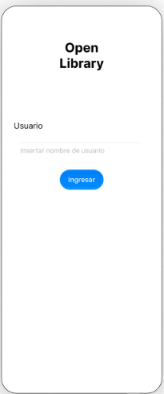
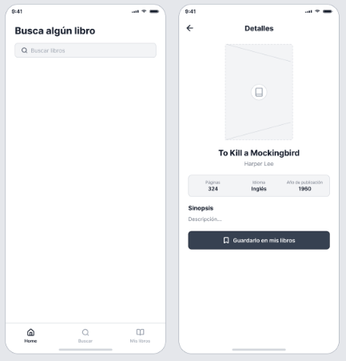
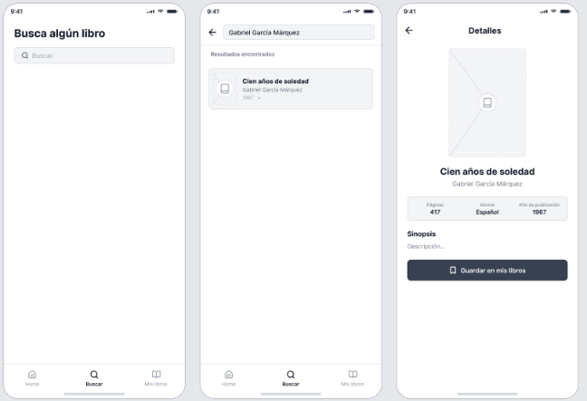
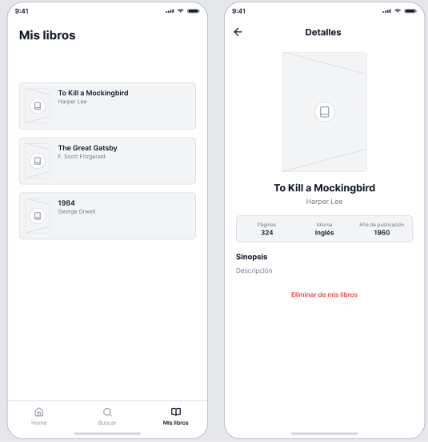

# Proyecto de desarrollo de aplicaciones IOS
# Proyecto Integrador

### Eleccion de proyecto:

- Opcion C: Aplicación de libros con OpenLibrary
- Objetivo: Permitir buscar libros, consultar información y administrar una lista personal de libros guardados.

### Integrantes de Equipo:

- Huerta Ruiz Diego Rafael
- Martinez Mejia Edgar

## Flujo:
- Inicio → lista de libros → detalle.
- Buscar → resultados → detalle.
- Mis libros → libro guardado → detalle.

# OpenLibrary

Somos una aplicación pensada para los amantes de la lectura que quieren tener el mundo de los libros al alcance de un toque.
Con esto sabemos que encontrar información de manera confiable sobre cualquier libro como lo es su sinopsis, autor, fecha de publicación o
número de páginas puede llegar hacer complicado cuando esta dispersa en distintas fuentes. Por eso se creó openlibrary, una de las bases de
datos de libros más grandes y abiertas del mundo con la finalidad de ofrecer cualquier información de manera rápida, clara y accecibles.

Con OpenLibrary se puede:
- Buscar cualquier libro por su título o autor y así obtener resultados al instante.
- Consultar el detalle de cada obra: portada, autor, idioma, fecha de publicación y una sinopsis que ayuda a decidir si es lo que está buscando.
- Guardar tus libros favoritos en tu propia biblioteca personal ("Mis libros"), para tenerlos siempre a la mano y consultarlos cuando quieras, sin la necesidad de volver a buscarlos.

## FLUJO 1:

- Se muestra la interfaz donde a primera vista aparece el nombre el nombre de la aplicacion como encabezado principal.
- Incluye un campo de texto con la etiqueta "usuario" y debajo aparece un recuadro que dice insertar nombre de usuario.
- El usuario inserta su nombre de usuario.
- Se muestra un botón que dice "ingresar"
- El usuario presionar el botón ingresar.

## FLUJO 2:

  

- Al ingresar, el usuario llega a una vista con el título "Busca algún libro" y una barra de búsqueda vacia, invitando a iniciar una consulta.
- En la parte inferior se encuentra la barra de navegación principal con tres pestañas: "Home", "Buscar", "Mis libros".
- El usuario escribe en la barra de búsqueda, el nombre de un autor como "Harper Lee".
- El sistema muestra el libro con el nombre del autor buscado.
- El usuario selecciona el libro de su preferencia que en su caso es: "To Kill a Mockingbird".
- El sistema muestra los detalles que tiene el libro que el usuario escogió como lo son: portada del libro, número de páginas, el idioma del libro y el año de publicación y en la parte de abajo de eso, una breve sinopsis del libro.
- Debajo de esos apartados se encuentra un botón que dice "Guardarlo en mis libros".
- El Usuario presiona el botón "Guardarlo en mis libros".
- Una vez añadido el libro, el sistema mostrará el mensaje que dice "Eliminar de mis libros" si el usuario quiere eliminarlo.
- El sistema muestra en la parte superior izquierda una flecha de regreso a la pestaña anterior.
- El usuario presiona la flecha de regreso.

## FLUJO 3:

- El Sistema muestra nuevamente la pestaña de "Busca algún libro".
- El usuario escribe en la barra de búsqueda, el nombre de un autor como "Gabriel García Marquez".
- El sistema muestra el libro con el nombre del autor buscado.
- El usuario selecciona el libro de su preferencia que en su caso es: "Cien años de soledad".
- El sistema muestra los detalles que tiene el libro que el usuario escogió como lo son: portada del libro, número de páginas, el idioma del libro y el año de publicación y en la parte de abajo de eso, una breve sinopsis del libro.
- Debajo de esos apartados se encuentra un botón que dice "Guardarlo en mis libros".
- El Usuario presiona el botón "Guardarlo en mis libros".
- Una vez añadido el libro, el sistema mostrará el mensaje que dice "Eliminar de mis libros" si el usuario quiere eliminarlo.
- El sistema muestra en la parte superior izquierda una flecha de regreso a la pestaña anterior.
- El usuario presiona la flecha de regreso.

## FLUJO 4:

- El Sistema muestra nuevamente la pestaña de "Busca algún libro".
- El usuario presiona en la parte inferior el botón de "Mis libros".
- El sistema muestra la pestaña de los libros que el usuario guardó.
- El usuario selecciona el libro "To Kill a Mockingbird" del autor llamado "Harper Lee".
- El sistema muestra los detalles que tiene el libro que el usuario escogió como lo son: portada del libro, número de páginas, el idioma del libro y el año de publicación y en la parte de abajo de eso, una breve sinopsis del libro.
- Debajo de esos apartados se encuentra un botón que dice "Eliminar de mis libros".

# Accesibilidad OpenLibrary

## Pantalla 1: Inicio de sesión

| Elemento                   | Tipo           | ¿Se anuncia? | Descripción                                                                      |
|----------------------------|----------------|--------------|----------------------------------------------------------------------------------|
| Open Library               | Encabezado     | Sí           | Se lee: "Open Library, encabezado".                                              |
| Etiqueta "Usuario" + campo | Campo de texto | Sí           | Un solo elemento. Se lee: "Usuario, campo de texto. Insertar nombre de usuario". |
| Botón Ingresar             | Botón          | Sí           | Se lee: "Ingresar, botón". Si está deshabilitado: "No disponible".               |
| Error de campo vacío       | Mensaje        | Sí           | Se anuncia al aparecer, sin mover el enfoque: "Escribe un nombre de usuario".    |

## Pantalla 2: Busca algún libro

| Elemento               | Tipo              | ¿Se anuncia? | Descripción                                             |
|------------------------|-------------------|--------------|---------------------------------------------------------|
| Busca algún libro      | Encabezado        | Sí           | Se lee: "Busca algún libro, encabezado".                |
| Barra de búsqueda      | Campo de búsqueda | Sí           | Se lee: "Buscar por título o autor, campo de búsqueda". |
| Lupa de la barra       | Ícono             | No           | Decorativa; la barra ya tiene etiqueta.                 |
| Pestaña Home           | Pestaña           | Sí           | Se lee: "Home, pestaña, seleccionada".                  |
| Pestaña Buscar         | Pestaña           | Sí           | Se lee: "Buscar, pestaña".                              |
| Pestaña Mis libros     | Pestaña           | Sí           | Se lee: "Mis libros, pestaña".                          |
| Íconos de las pestañas | Ícono             | No           | Se lee solo el texto de la pestaña.                     |

## Pantalla 3: Detalle del libro (guardar)

| Elemento                    | Tipo       | ¿Se anuncia? | Descripción                                                                                                                  |
|-----------------------------|------------|--------------|------------------------------------------------------------------------------------------------------------------------------|
| Flecha de regreso           | Botón      | Sí           | Se lee: "Regresar, botón".                                                                                                   |
| Detalles                    | Encabezado | Sí           | Se lee: "Detalles, encabezado".                                                                                              |
| Portada                     | Imagen     | Sí           | Se lee: "Portada de To Kill a Mockingbird".                                                                                  |
| Título del libro            | Encabezado | Sí           | Se lee: "To Kill a Mockingbird, encabezado".                                                                                 |
| Autor                       | Texto      | Sí           | Se lee: "Harper Lee".                                                                                                        |
| Páginas                     | Texto      | Sí           | Una sola frase: "Páginas: 324".                                                                                              |
| Idioma                      | Texto      | Sí           | Una sola frase: "Idioma: Inglés".                                                                                            |
| Año de publicación          | Texto      | Sí           | Una sola frase: "Año de publicación: 1960".                                                                                  |
| Sinopsis                    | Encabezado | Sí           | Se lee: "Sinopsis, encabezado".                                                                                              |
| Texto de la sinopsis        | Texto      | Sí           | Se lee el párrafo completo. Si es largo, ofrecer "Ver más".                                                                  |
| Botón Guardar en mis libros | Botón      | Sí           | Se lee: "Guardar en mis libros, botón".                                                                                      |
| Ícono de marcador del botón | Ícono      | No           | El texto ya dice la acción.                                                                                                  |
| Cambio de estado al guardar | Mensaje    | Sí           | Se anuncia: "Libro guardado en Mis libros". El enfoque se queda en el botón, que ahora dice "Eliminar de mis libros, botón". |

## Pantalla 4: Resultados de búsqueda

| Elemento                           | Tipo              | ¿Se anuncia? | Descripción                                                                                                       |
|------------------------------------|-------------------|--------------|-------------------------------------------------------------------------------------------------------------------|
| Flecha de regreso                  | Botón             | Sí           | Se lee: "Regresar, botón".                                                                                        |
| Campo con texto buscado            | Campo de búsqueda | Sí           | Se lee: "Buscar por título o autor, campo de búsqueda, Gabriel García Márquez".                                   |
| Resultados encontrados             | Encabezado        | Sí           | Se lee: "Resultados encontrados, encabezado".                                                                     |
| Estado de carga                    | Mensaje           | Sí           | Se anuncia automáticamente: "Cargando resultados".                                                                |
| Tarjeta del libro                  | Botón             | Sí           | Un solo elemento con título, autor y año. Se lee: "Cien años de soledad, de Gabriel García Márquez, 1967, botón". |
| Portada/ícono dentro de la tarjeta | Imagen            | No           | No es necesario describir la imagen porque el título ya identifica el libro.                                      |
| Sin resultados                     | Mensaje           | Sí           | Se anuncia: "Sin resultados para Gabriel García Márquez".                                                         |

## Pantalla 5: Mis libros

| Elemento                      | Tipo       | ¿Se anuncia? | Descripción                                                              |
|-------------------------------|------------|--------------|--------------------------------------------------------------------------|
| Mis libros                    | Encabezado | Sí           | Se lee: "Mis libros, encabezado".                                        |
| Lista de libros guardados     | Lista      | Sí           | Se lee: "Lista, 3 elementos".                                            |
| Tarjeta de libro              | Botón      | Sí           | Un solo elemento. Se lee: "To Kill a Mockingbird, de Harper Lee, botón". |
| Íconos de portada en tarjetas | Ícono      | No           | Decorativos.                                                             |
| Pestaña Mis libros            | Pestaña    | Sí           | Se lee: "Mis libros, pestaña, seleccionada".                             |
| Estado vacío                  | Mensaje    | Sí           | Se lee: "Aún no has guardado libros".                                    |

## Pantalla 6: Detalle desde Mis libros (eliminar)

| Elemento               | Tipo               | ¿Se anuncia? | Descripción                                                                                |
|------------------------|--------------------|--------------|--------------------------------------------------------------------------------------------|
| Flecha de regreso      | Botón              | Sí           | Se lee: "Regresar, botón".                                                                 |
| Detalles               | Encabezado         | Sí           | Se lee: "Detalles, encabezado".                                                            |
| Portada                | Imagen             | Sí           | Se lee: "Portada de To Kill a Mockingbird".                                                |
| Título del libro       | Encabezado         | Sí           | Se lee: "To Kill a Mockingbird, encabezado".                                               |
| Autor                  | Texto              | Sí           | Se lee: "Harper Lee".                                                                      |
| Páginas / Idioma / Año | Texto              | Sí           | Cada dato en una sola frase: "Páginas: 324", "Idioma: Inglés", "Año de publicación: 1960". |
| Sinopsis               | Encabezado y texto | Sí           | Se lee: "Sinopsis, encabezado" y luego el párrafo.                                         |
| Eliminar de mis libros | Botón              | Sí           | Se lee: "Eliminar de mis libros, botón".                                                   |
| Resultado de eliminar  | Mensaje            | Sí           | Se anuncia: "Libro eliminado de Mis libros".                                               |

## Estado actual de las vistas

Se revisó qué hace cada vista además de dibujar la pantalla:

| Vista | Responsabilidades que tiene ahora | ¿Debería salir de la vista? |
|---|---|---|
| `LoginView` | Valida que el nombre no esté vacío, quita espacios, decide el mensaje de error y guarda el usuario. | La validación sí. Mostrar el campo y el error se queda. |
| `SearchView` | Guarda texto y resultados, filtra `Book.samples`, simula la espera, maneja los estados (inicial, cargando, con resultados, sin resultados). | Sí, es la que más lógica tiene. |
| `BookDetailView` | Pregunta si el libro está guardado y decide si agrega o elimina. A futuro cargará la sinopsis. | En parte, sobre todo la carga de datos. |
| `MyBooksView` | Solo lee el store y muestra la lista. | No, ya es muy simple. |
| `HomeView` | Muestra el saludo con el usuario. | No. |
